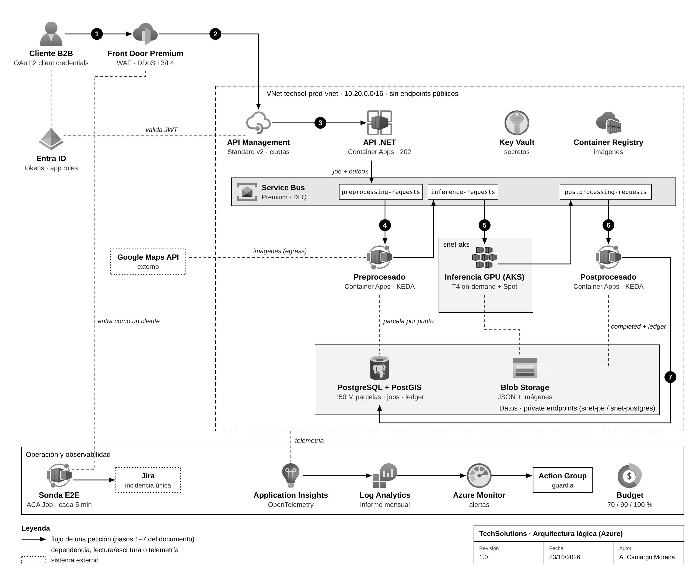

# TechSolutions · API B2B de visión artificial en Azure

**Turing Challenge · Prueba técnica de arquitectura · Atilio Camargo Moreira · octubre 2026**

📄 **Documento principal:** [`docs/TechSolutions_Arquitectura_Azure_AtilioCamargo.pdf`](docs/TechSolutions_Arquitectura_Azure_AtilioCamargo.pdf)

Este repositorio acompaña al documento. Es un esqueleto real (compila, tiene tests y la infraestructura valida), no un sistema terminado: el modelo de IA y los conectores a Google y al catastro quedan fuera.

## Arquitectura



Los números siguen el flujo de una petición descrito en el documento (sección 3). Fuentes: [`architecture.drawio`](docs/diagrams/architecture.drawio) (editable) y [`architecture.svg`](docs/diagrams/architecture.svg).

## Contenido

| Ruta | Qué hay |
|---|---|
| `src/TechSolutions.Api` | API .NET 10: `POST/GET /v1/evaluations`, `Idempotency-Key` con jobId determinista, aislamiento por tenant, JWT de Entra ID. |
| `src/TechSolutions.Worker` | Worker de referencia que consume la cola de su etapa (los handlers reales del pipeline no están). |
| `src/TechSolutions.SyntheticMonitor*` | Sonda E2E: envía la parcela "golden", valida con tolerancia y abre/actualiza la incidencia en Jira sin duplicar. |
| `tests/` | 19 tests: contrato e idempotencia de la API, validación de la sonda y deduplicación en Jira. |
| `infra/` | Bicep modular: red privada, Storage, Service Bus, Key Vault, ACR, PostgreSQL + PostGIS, Container Apps, AKS GPU, APIM, Front Door + WAF, alertas y presupuesto. Parámetros de dev y prod. |
| `infra/monthly-report.kql` | Informe mensual de tiempos, volumen y errores por cliente. |
| `apim/policies/` | Política de la API (JWT, tenant desde el token, solo tráfico de Front Door, métrica de uso) y una por producto (Bronze/Silver/Gold/Synthetic). |
| `.azuredevops/` | Pipeline multi-stage: CI con gates, dev, prod con aprobación y canary. |
| `docs/` | Documento PDF, ADR y operación. |

## Ejecutar en local

```bash
dotnet test TuringChallenge.sln

cd src/TechSolutions.Api
dotnet run --environment Development      # DemoMode: estado en memoria, sin Azure

curl -i -X POST http://localhost:5000/v1/evaluations \
  -H 'Content-Type: application/json' -H 'Idempotency-Key: demo-001' \
  -d '{"address":"Calle Mayor 1, Madrid"}'
```

El mismo `Idempotency-Key` devuelve el mismo `jobId`. Ajusta el puerto al que muestre `dotnet run`.

## Infraestructura

```bash
az bicep build -f infra/main.bicep
az deployment group what-if -g <rg> -f infra/main.bicep -p infra/main.dev.bicepparam
```

Requisitos previos fuera de la plantilla: app registration de la API con el rol `TechSolutions.Submit`, grupo de Entra para administrar PostgreSQL, secretos en Key Vault (`jira-user`, `jira-api-token`, `probe-subscription-key`) y cuota de GPU en la región.

## Números clave

- 2 + 10 + 3 = 15 s por petición; a 50 RPS hay 750 peticiones en vuelo. Por eso la API es asíncrona.
- 2 M peticiones/año = 0,063 RPS de media; los 50 RPS solo pueden ser ráfagas.
- Coste base estimado: ~3,4 k€/mes en valle, ~5,2 k€/mes en pico, ~46 k€/año (Google Maps aparte).
